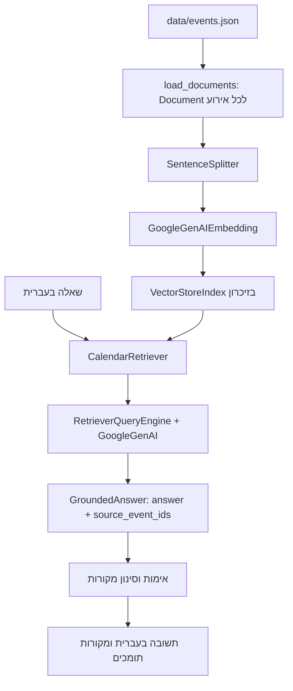

# ארכיטקטורת Calendar RAG Assistant

המסמך מתאר את המימוש הקיים ב־[main.py](../main.py). המערכת היא יישום טרמינל יחיד, עם אינדקס מקומי בזיכרון ושירותי Google ליצירת embeddings ולניסוח תשובות.

## התהליך מקצה לקצה



כל סוגי השאלות נשארים בתהליך Retrieval → LLM → Answer → Sources. זיהוי מסננים וחישוב מספר ההתאמות הם פעולות עזר לשליפה; הם אינם מחליפים את ניסוח התשובה באמצעות המודל.

## 1. מקור הנתונים ו־Documents

`load_documents()` קוראת את `data/events.json` בקידוד `utf-8-sig`. במאגר הנוכחי יש 40 אירועים. לכל אירוע נוצר `Document` נפרד:

- `id_` הוא מזהה האירוע, למשל `event-001`.
- הטקסט נכתב בעברית וכולל שם אירוע, סוג, יום עברי, חודש עברי, שם לוח, הרשאה וחזרה שנתית בניסוח כן/לא.
- `metadata=dict(event)` שומר את כל שדות האירוע ללא שינוי.

| שדה metadata | משמעות |
|---|---|
| `id` | מזהה קבוע המשמש גם לעקיבות המקורות |
| `title` | שם אדם או אירוע |
| `type` | סוג האירוע |
| `hebrewDay` | יום עברי, כגון `כ״ז` |
| `hebrewMonth` | חודש עברי, כגון `חשוון` |
| `calendarName` | שם הלוח |
| `permission` | `פרטי` או `משותף` |
| `repeatsYearly` | נתון בוליאני על חזרה שנתית |

אין `sourceYear`. הקוד אינו מוסיף שנה, מחשב גיל או יוצר אירועים נוספים כתוצאה מ־`repeatsYearly`. שדה ההרשאה אינו מנגנון בקרת גישה.

## 2. Chunking

בעת בניית האינדקס מופעל:

```python
SentenceSplitter(chunk_size=1024, chunk_overlap=0)
```

ה־splitter מפיק nodes מתוך המסמכים ושומר את הקשר ל־metadata. `chunk_size` מתייחס לתקציב הטוקנים של ה־splitter, ולא למספר אירועים או למספר תווים. האירועים הקצרים שבמאגר הפיקו 40 nodes בבדיקות הפיתוח; אין בקוד התחייבות שמסמך ארוך יותר יישאר תמיד node יחיד.

## 3. Embeddings ו־VectorStoreIndex

ה־embeddings נוצרים באמצעות:

```python
GoogleGenAIEmbedding(
    model_name="gemini-embedding-001",
    api_key=api_key,
    retries=1,
    http_options=types.HttpOptions(
        retry_options=types.HttpRetryOptions(attempts=1)
    ),
)
```

`VectorStoreIndex.from_documents(...)` מקבל את המסמכים, ה־embedding model וה־splitter. האינדקס וה־docstore מוחזקים בזיכרון. אין בקוד `persist` או טעינה מאינדקס שמור, ולכן כל הפעלה בונה מחדש את הייצוגים של האירועים.

ה־Retriever פונה לאותו אינדקס גם במסלולי סינון metadata. המימוש הנוכחי משתמש ב־Vector Retriever גם לצורך סינון מדויק, ולכן מסלול כזה עשוי עדיין להזדקק ל־embedding של השאלה.

## 4. Retrieval וזיהוי כוונה

`CalendarRetriever` יורש מ־`BaseRetriever`. הוא בונה קטלוג של שדות האירועים מתוך ה־nodes שב־`index.docstore`; זהו חלק ממנגנון השליפה מהאינדקס, ולא מאגר JSON נפרד המשמש למתן תשובות.

הזיהוי מבוסס על ביטויים רגולריים ומפות כינויים. למשל, `חשון` מנורמל ל־`חשוון`, ושני האיותים `ארועים` ו־`אירועים` מזוהים בבקשות רשימה.

### רשימות ומסננים

בבקשה רחבה מזוהים מסננים כגון חודש, סוג, לוח ויום. השליפה משתמשת ב־`MetadataFilters`:

- לערך יחיד בשדה נוצר מסנן `EQ`.
- למספר ערכים באותו שדה נוצר מסנן `IN`.
- מסננים של שדות שונים משולבים ב־AND.
- יום וחודש מזוהים מסוננים יחד. אם זוהה יום מפורש ללא חודש, מסונן היום בלבד.

כדי להחזיר את כל התאמות הרשימה, תקרת `similarity_top_k` נקבעת לפי מספר ה־nodes באינדקס. לכן התוצאות אינן נחתכות לשלוש כאשר יש שמונה התאמות בחשוון, למשל. הקשר מלא זה מסומן כ־`retrieval_mode=list` ומועבר ל־LLM.

### ספירה

לאחר שליפה מלאה, מספר האירועים מחושב באמצעות מספר מזהי `id` הייחודיים. כך אירוע שפוצל למספר nodes לא ייספר כמה פעמים. המספר מועבר בהקשר כ־`retrieval_count`, עם `retrieval_mode=count`. ה־LLM מנסח את תשובת הספירה ומונחה להתחיל ב־`יש N אירועים`.

### שאלות נקודתיות

הקוד מחלץ שם מבוקש ומחפש התאמת `title` מדויקת בתוך מסנני הסוג וה־metadata שנמצאו. בהתאמה ייחודית לשם מלא מוחזר בדרך כלל אירוע אחד. שם קצר עם התאמות ארוכות דומות עשוי להחזיר את המדויק ועוד עד שני מועמדים.

כשאין התאמה מדויקת, נעשה שימוש בשליפה סמנטית עם `similarity_top_k=3`. כאשר חולץ שם, המועמדים נבדקים גם לפי דמיון מילולי. מועמדים של שמות שאינם מתאימים יכולים להיפסל לפני הניסוח, כדי שלא יוצגו אנשים אחרים כתשובה לשאלה על שם חסר.

ל־nodes מועתקים נוסף metadata זמני כגון `match_quality`, `needs_clarification` ו־`retrieval_mode`. הנתונים המקוריים בקובץ אינם משתנים.

### שאלה על שם הלוח

`calendar_lookup_target()` מזהה ניסוחים כמו `באיזה לוח נמצא יוסף?` לפני סינון ה־metadata. בכוונה זו המילה שלאחר `לוח` אינה מפורשת כשם לוח לסינון. במקום זאת מחולץ שם האירוע, מתבצעת אותה שליפה, והמודל מתבקש לענות לפי `calendarName`. כמה התאמות מועברות כאפשרויות עם בקשת הבהרה.

### אין התאמה או דרושה הבהרה

כאשר אין אירועים מתאימים, או שהמסננים אינם חד־משמעיים, ה־Retriever מחזיר node של מצב שליפה (`retrieval_status`). זהו הקשר למודל, לא אירוע חדש. כך גם תשובת חוסר המידע עוברת דרך ה־LLM. node כזה אינו מוצג כמקור אירוע.

## 5. LLM וניסוח

`RetrieverQueryEngine.from_args(...)` משתמש ב־`response_mode="compact"` ובמודל:

```python
GoogleGenAI(
    model="gemini-3.5-flash-lite",
    api_key=api_key,
    http_options=types.HttpOptions(
        timeout=60000,
        retry_options=types.HttpRetryOptions(attempts=1),
    ),
    max_retries=0,
    generation_config=types.GenerateContentConfig(
        thinking_config=types.ThinkingConfig(thinking_level="minimal"),
    ),
)
```

הפרומפט מחייב עברית, הסתמכות על ההקשר, שמירת ערכי metadata והימנעות מהמצאת מידע. ברשימות יש לפרט את כל ההתאמות לפי לוח; בשאלות נקודתיות נדרשת תשובה קצרה; בעמימות נדרשת הבהרה.

הפלט הפנימי הוא `GroundedAnswer`, הכולל:

- `answer`: התשובה בעברית.
- `source_event_ids`: מזהי האירועים שהמודל מציין כתומכים בטענותיו.

זהו פלט מובנה של אותה בקשת ניסוח. לא קיים בקוד מודל נוסף השופט את התשובה.

## 6. אימות ומקורות

`supported_response()` חותכת את מזהי המקורות שהמודל ציין עם מזהי האירועים הקיימים ב־`response.source_nodes`. רק האירועים שנותרו מוצגים למשתמש, בפורמט:

```text
שם האירוע | סוג | יום וחודש | שם הלוח
```

כשאין מקורות מתאימים מוצג:

```text
מקורות: לא נמצאו מקורות מתאימים.
```

בבקשת רשימת יום ללא חודש נוסף `day_only_query=True`. במקרה זה `validate_day_only_answer()` מאמתת גם את שורות התשובה עצמן: שם, סוג, יום וחודש ולוח חייבים להתאים בדיוק לערכי האירועים שנשלפו, ומזהי המקורות חייבים להתאים לכל האירועים בתשובה. תשובה שלא עוברת את הבדיקה נחסמת; לא נבנית במקומה תשובה אוטומטית מהנתונים.

במסלולים אחרים נבדקת חברות מזהה המקור בשליפה, אך אין אימות מלא של כל טענה בשפה חופשית. אין להציג את מנגנון המקורות כהוכחה מוחלטת להיעדר טעויות.

התמיכה ביום ללא חודש אינה מלאה: T07 הצליחה בהרצה מוקדמת, אך נכשלה בבדיקה מאוחרת בגלל האימות המחמיר, למרות ארבע התאמות במאגר. כמו כן דווחה ספירה של 3 במקום 4 בשאלה „כמה הערות יש בכסלו?”, עם השמטת „טיפול שיניים” מלוח משפחה; סיבת התקלה לא אומתה. התיאור הארכיטקטוני מסביר את המסלול הממומש, ואינו טוען שכל המקרים הללו נפתרו.

## 7. שגיאות ותלות בשירות חיצוני

פסק הזמן של בקשת ה־LLM הוא 60 שניות. לולאת השאלות מאפשרת ניסיון ראשון ועוד ניסיון חוזר אחד בלבד ב־504 או בשגיאות transport מסוימות. ניסיונות חוזרים פנימיים ב־SDK ובמתאם מוגבלים כך שלא יצטברו לולאות retry רבות.

429 מוצגת כשגיאת מכסה, ללא ניסיון לעקוף אותה באמצעות תשובה ישירה מה־JSON. כשל בהקמת האינדקס מדפיס סוג, קוד אם קיים והודעה עם הסתרת המפתח. אין מנגנון שממתין לאיפוס המכסה ומנסה לשחזר את האינדקס אוטומטית לאחר כשל; הודעת האבחון אינה פתרון לחריגה מהמכסה.

למידע על בדיקות ומגבלות: [בדיקות](tests.md), [בעיות ושיפורים](issues-and-improvements.md).
